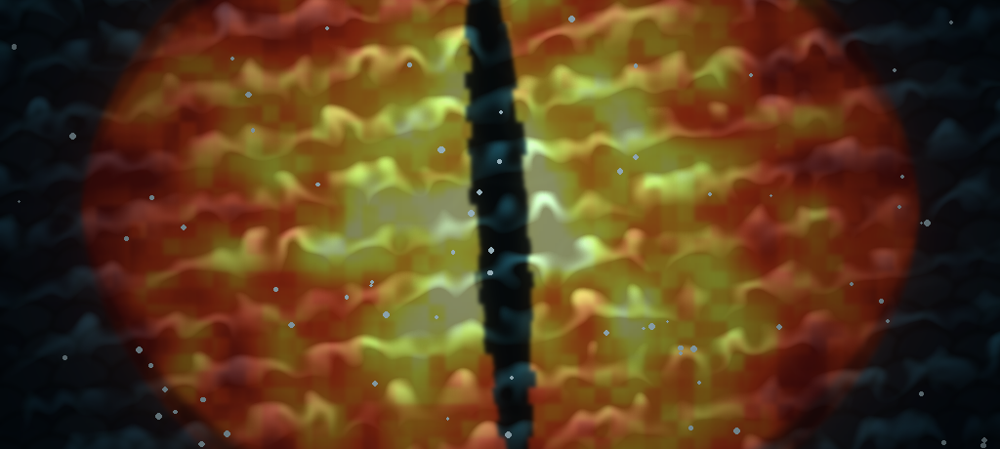
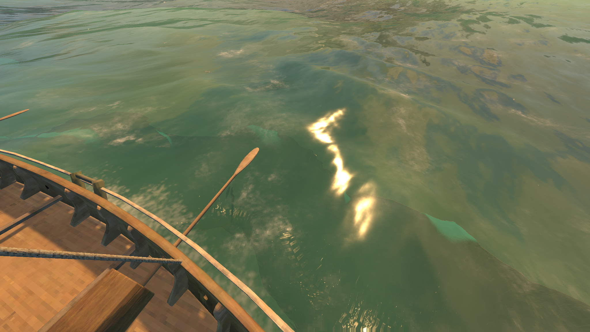
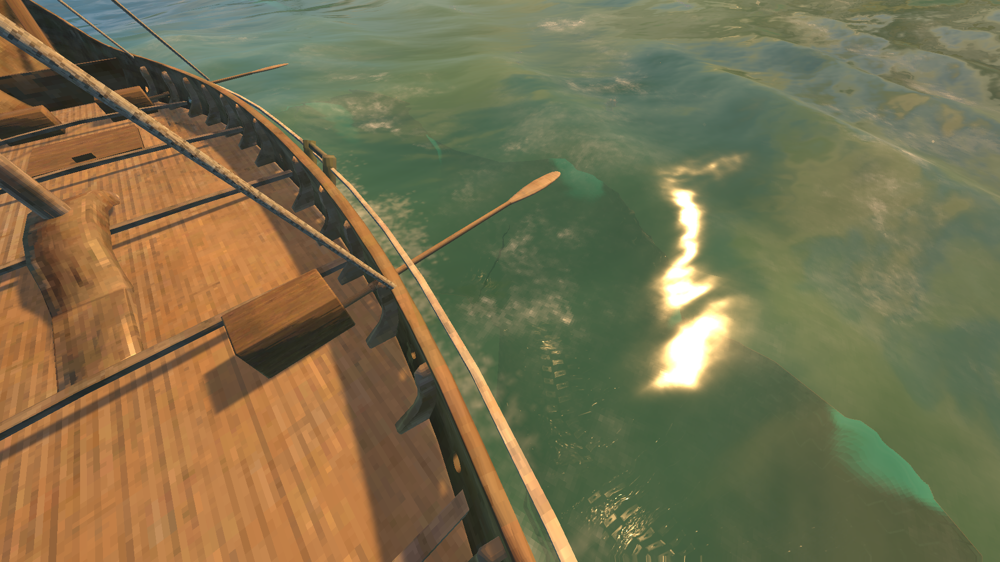
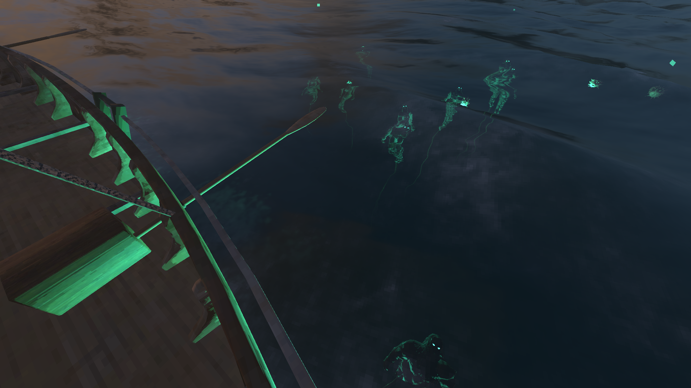
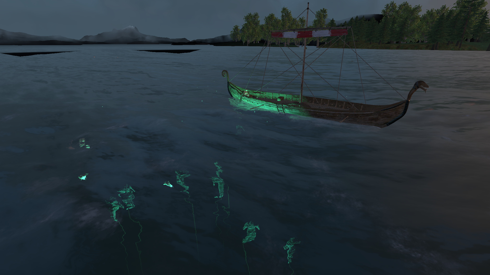
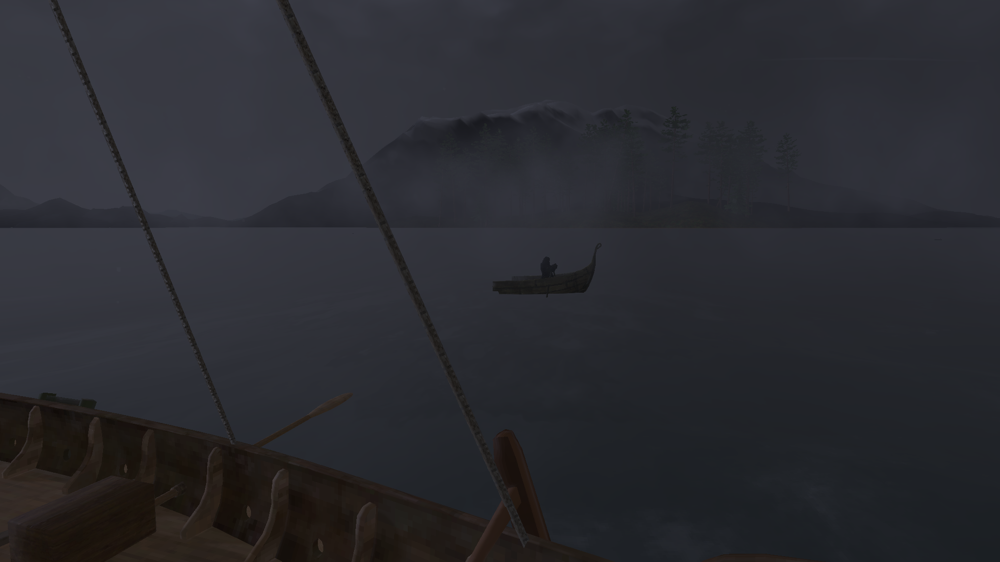
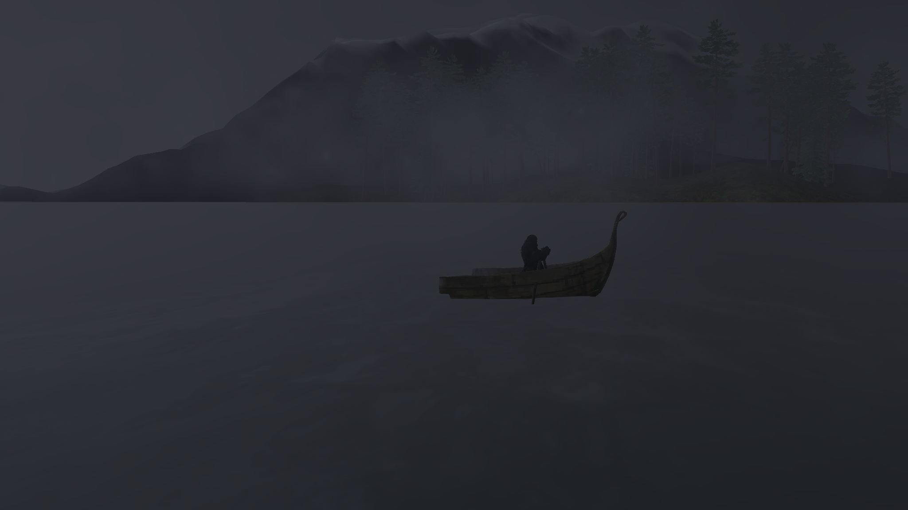
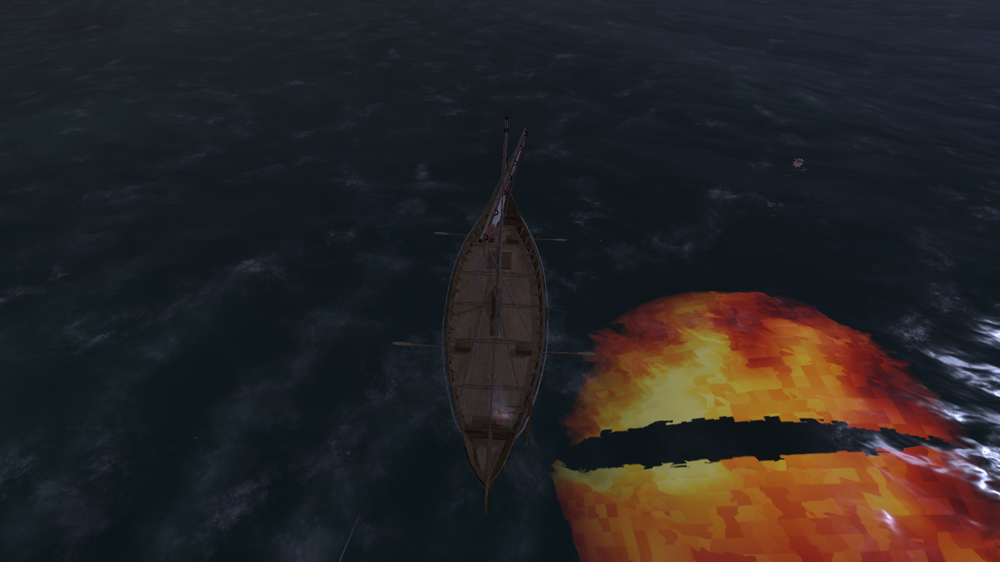
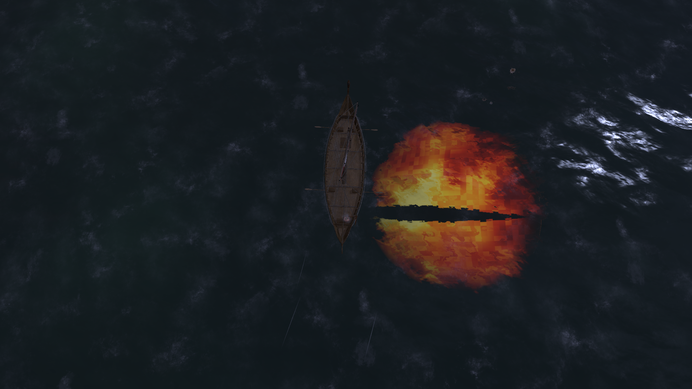

# Below the Keel

Sailing Valheim's open sea can be peaceful, or it can be an hour of nothing. Below the Keel puts something under it.

Far from land, in deep water, now and then something happens. Something you might see if you're looking over the side at the right moment, and might miss if you aren't. None of it can hurt you, slow you or touch your ship: it's there to be seen, and to make you less sure about the water under you.

## The omens

Four of them, drawn from Norse lore. Described lightly here, so there's something left to find. The pictures are behind spoilers: click one only if you want to know.

**The Pacer.** Something long and dark keeps pace under the ship. However long you watch, there is always more of it.

Spoiler: the Pacer

**Rán's Net.** The sea goddess Rán drags sailors down in her net. Sometimes you sail over the ones she caught.

Spoiler: Rán's Net

**The Half-Boat.** In Norwegian folklore, a drowned fisherman rows half a boat through the fog, and seeing him means someone aboard will drown. Only in fog or at night.

Spoiler: the Half-Boat

**The Eye.** Easy to miss. Hard to forget.

Spoiler: the Eye

## When they come

- Only in the **Ocean biome**, at least **25 m** deep, with **no land within 250 m**: out on the open sea, never along the coast.
- About **one every 20 minutes** of sailing out there, **twice as often at night**, and never two within 6 minutes of each other.
- **A fail-safe**: after 40 minutes on the open sea with none (bad luck happens), the next chance out there brings one.
- While you're aboard a ship. They come to the ship, not to a swimmer.

## Sailing together

- **Everyone aboard the same ship sees the same omen at the same moment.** No messages are sent for it: every player's game works out the same answer from the ship and the server's clock. So someone shouting "look down!" isn't the only one who saw it.
- **The server doesn't need the mod**, and players without it are never affected. If the server has it, its settings for *when* omens come are used by everyone, so the whole crew stays in step.
- **Multiplayer is untested.** It's built for crews, but so far it has only been played in single player. If two players aboard see different things, please report it.

## Settings

Everything is in the F1 Configuration Manager.

| Section | What's in it |
|---|---|
| **1 - When** | How many minutes between omens on average (20), the least time between two (6), the least water depth (25 m), the least distance from land (250 m), how much more often they come at night (2×), and the fail-safe (40 minutes; 0 turns it off). The server decides these. |
| **2 - Omens** | Turn omens off altogether, or any one of them. Each player's own: if you turn one off, you just don't see it when your crew does. |

## Console commands

For trying them out (F5 console; turn the console on in Settings → Gameplay). They only show things on your own screen.

| Command | What it does |
|---|---|
| `keel status` | The depth here and whether omens can come, the time at sea since the last omen, the weather and how far the fog lets you see |
| `keel next` | When the next three omens are due (spoilers!) |
| `keel play pacer` / `ransnet` / `halfboat` / `eye` | Play one now |
| `keel play halfboat near` | The Half-Boat held alongside for a minute, to look at |
| `keel play eye show` | The Eye lifted above the water, held open for a minute, to look at |
| `keel play eye classic` | The Eye as it first was, with whites |
| `keel pose` | One of Rán's drowned held above the water beside the ship |
| `keel depths` | How deep your world's ocean is, from the world generator |

## Other mods and known clashes

- No clashes are known. It changes nothing in the game itself; it only adds things to look at, made from the game's own models and materials.
- Nothing it shows is saved with the world or sent to other players. The only thing it keeps is one number on each ship (its time at sea since the last omen, for the fail-safe); removing the mod leaves that unused and harmless.
- Mods that change the ocean, the water's look or the fog may change how well the omens can be seen.

## Made with AI

Made with the help of Claude (Anthropic).
