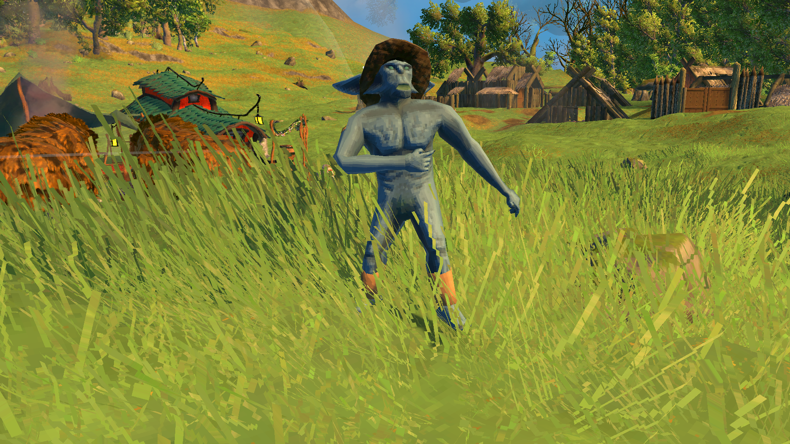
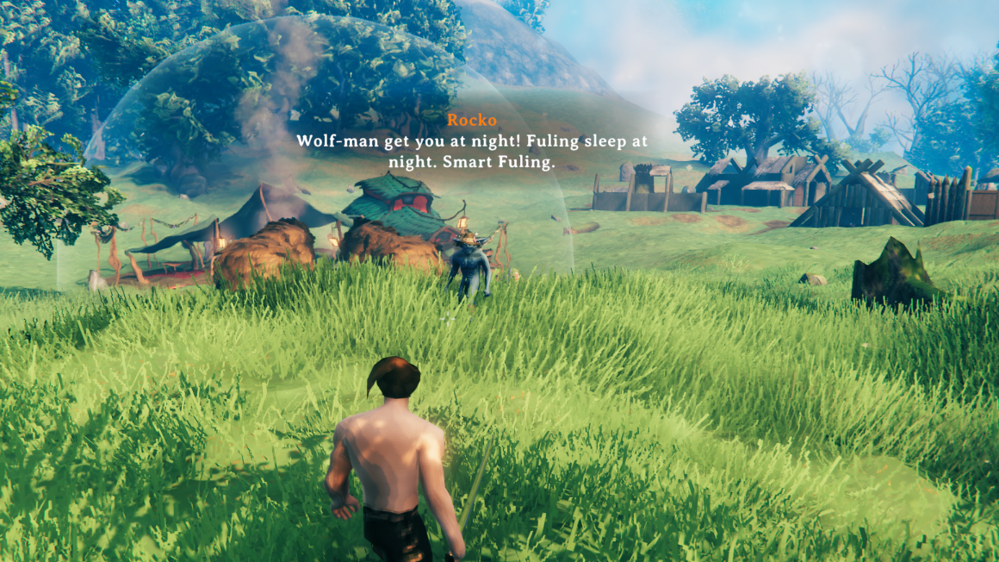
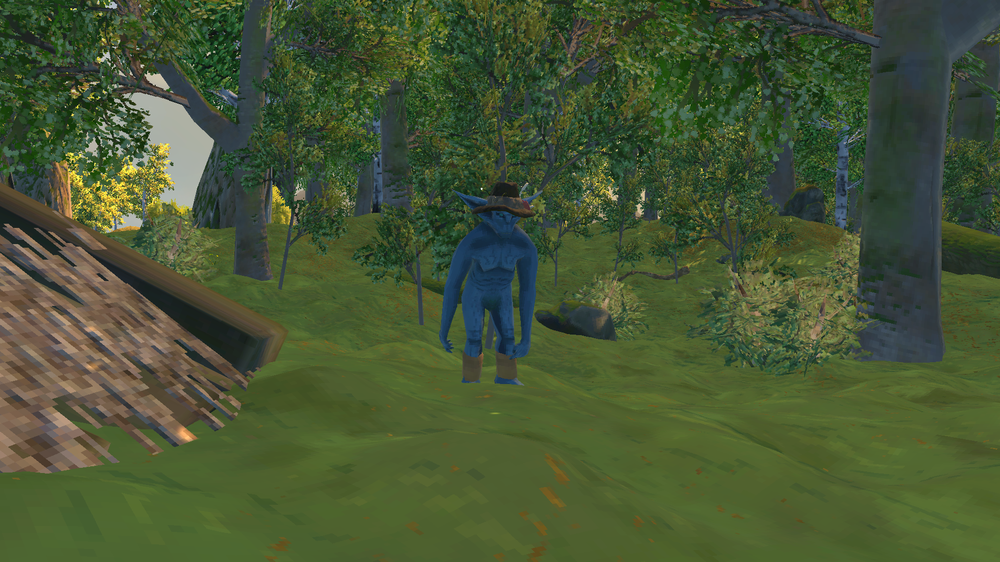
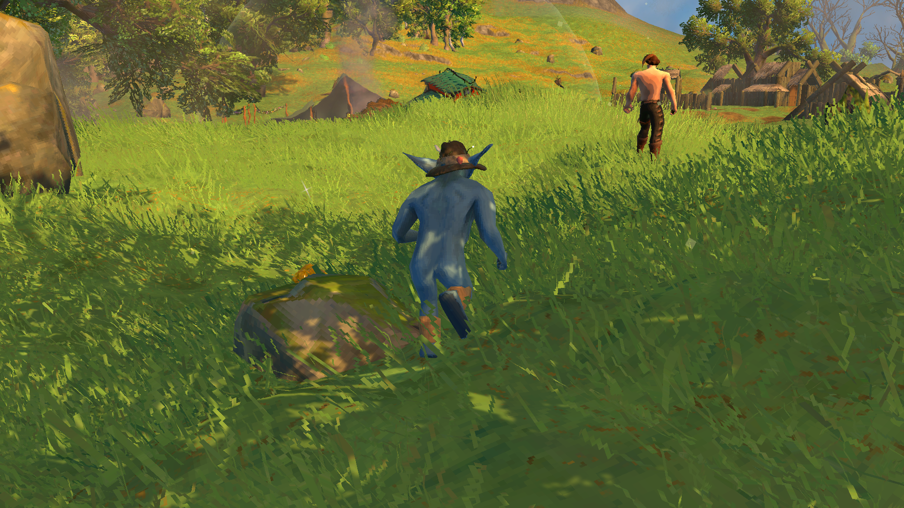
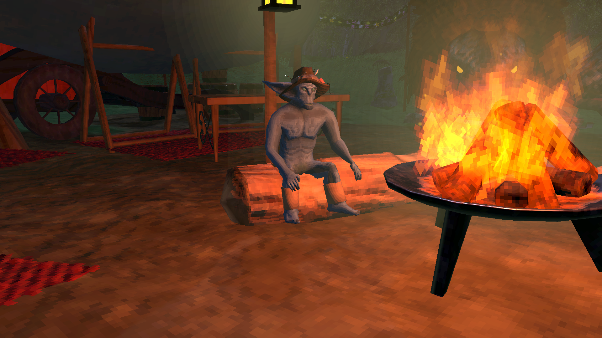
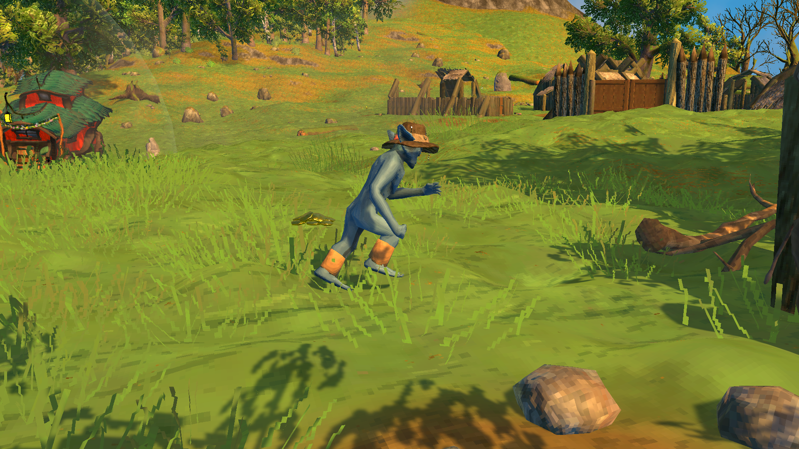

# Fuling Heckler



A comedy mod. Valheim's deaths can sting: the troll that flattened you, the cliff you misjudged, the swim you shouldn't have tried. Fuling Heckler adds a little levity to them, and to the quiet stretches in between, in the shape of one cheeky goblin who thinks your misfortunes are the funniest thing in the world. Out of the box he changes nothing about how the game plays (the two pranks that touch your items are off until you switch them on): he's only there to make you laugh, or groan.

When you die, a Fuling runs over, laughs at you, and runs off.

- He keeps count of every way you've died, per character, and brings it up. First times and milestones (your 5th, 10th, 25th troll death...) always get a visit.
- Sometimes he wears something on his head. At night he sometimes brings a torch.
- He hops when he arrives, then laughs, points or flexes at you using the player emotes, or takes a mock swing. Now and then he acts out your death: a hard landing after a fall, swimming on dry land after drowning.
- He also turns up uninvited: lurking at the edge of your camp, creeping up while you aren't looking, dancing on your grave, copying your emotes.



He isn't a real creature. He has no AI, nothing about him is saved in the world, and he can't hurt anyone. On your own world he's yours alone. On a server that has the mod, everyone with it shares one goblin and sees him heckle each other.

*(This mod used to be called Ravens Remember. Your death tallies carry over on their own; delete the old `RavensRemember` plugin folder so the two don't run at once.)*

## He turns up uninvited

Every 20-40 minutes of play (you can change this), one of these happens:

- **Lurker:** he stands off to your side, 20-30 m away, staring. Turn and look right at him and he flinches and bolts. Ignore him long enough and he gets bored and leaves.

  

- **Red Light Green Light:** he creeps up from behind, but only while you're not looking. Turn around and he freezes mid-pose. If he reaches you, he waits for you to turn around... BOO.

  

- **Copycat:** he appears in front of you and copies your emotes (/wave, /dance, /flex...). After 40 seconds he waves and leaves. Point at him and he takes offence and leaves.

And at the right moments:

- **Tombstone Dancer:** when you head back to where you died, he might be dancing on your grave. Get close and he runs off.
- **Campfire Squatter:** at night, coming back to a lit fire (campfire, hearth, bonfire or brazier), he might be sitting by it, on a chair, bench or log bench if there is one nearby. He bolts when you get close.

  


Two scenes use real items, so both are **off by default**:

- **Coin Thief:** if you carry at least 50 coins, he grabs 10 and runs, dropping them one by one so you can follow the trail and get them all back. A coin only leaves your pocket once it has been dropped, so nothing is lost. The dropped coins are real items: other players can pick them up too. **Coin Thief Fee** (default 0) lets him keep a few.

  

- **Gifter:** he sneaks up from behind and slips 1-3 things into your pockets, then vanishes. All you're told is "Your pockets feel heavier...", so you find out later. Mostly junk (Pukeberries, bone fragments, stones), sometimes something nice, rarely treasure. Cheap equipment he gives (rags, a club, a wooden shield) says **Crafted by** his name. Turn around and catch him and he drops it all on the ground and bolts.
  - He only comes if you have at least 5 empty slots, never takes your last slot, never pushes you over your carry weight, and stays away while you're heading back to your grave.
  - What he gives is in `BepInEx\config\FulingHeckler.loot.txt`: `item | weight | amount | tier`, one per line. Edit it, then press **Reload loot table** in F1.

He never turns up during fights, on boats, in water, in dungeons, in bed, or while he's already out. Every scene has a **Test** button in F1.

## Settings (F1)

Everything is in the F1 Configuration Manager, grouped by what it's for. Tick **Advanced settings** at the top to see the fine-tuning too: distances, speeds, animations, effects and the diagnostics.

| Section | What's in it |
|---|---|
| **1 - General** | On/off; when he comes in person (**Delivery**: first-time deaths and milestones, or **Always**); where his line goes otherwise (**Text Position**: the chat window, a screen corner, mid-screen, or off); how often he comments on repeat deaths and the cooldown; **Share Goblin On My Server**. *(Advanced: always on first-time deaths, the delay after you respawn, how long his bubble stays, milestones.)* |
| **2 - Deaths** | Which kinds of death he comments on: environment, falling, trees, creatures, friendly fire, other |
| **3 - Look** | His name (**Rocko**) and how often he uses it, his body, skin colour, helmet (a fishing hat), outfit, and the torch he sometimes brings at night. *(Advanced: held-item size, torch poses.)* |
| **4 - Hat Fitting** | Fitting player helmets onto his head by eye (below). *(Advanced: the saved fits, the dropdown's list.)* |
| **5 - Visits** | How a death visit plays out: **Personal Space** (walk closer and he bolts), how often he taunts, hops, or plays dead. *(Advanced: how close he stops, how far he runs, his emotes and **Death Impressions**.)* |
| **6 - Scenes** | How often he turns up uninvited, then each scene's on/off, **Test** button and chance. *(Advanced: each scene's distances, speeds and poses.)* |
| **7 - Thief & Gifter** | The two scenes that use real items, each with its options and a **Test** button, and **Reload loot table**. *(Advanced: signed gifts, the grab animation, the coin trail.)* |
| **8 - Smoke & Sounds** | His smoke puff and its sound, your own recordings (**Custom Sounds**, their volume, **Open Sounds Folder**, **Reload Sounds**). *(Advanced: which game effects make the puff, and its size.)* |
| **9 - Tools** | Summon him, reload the quips file, make him forget your deaths. *(Advanced: debug logging, **Echo Test**, and tests for the torch, outfit, emotes and puffs.)* |

Files the mod keeps in `BepInEx\config\`:
- `nick.valheim.fulingheckler.cfg`: the settings above. (Before 1.6.0 it was `nick.FulingHeckler.cfg`; your old settings are copied over the first time.)
- `FulingHeckler.quips.txt`: everything he can say, in English. Edit freely (see below).
- `FulingHeckler.loot.txt`: what the Gifter slips into your pockets.
- `FulingHeckler_memory\<character>.txt`: his death tallies.
- `FulingHeckler_sounds\`: your own sounds (below).

## Console commands

For trying him out (F5 console; turn the console on in Settings → Gameplay). The same as the **Test** buttons in F1; the Gifter's test, which hands out items, needs the game's cheats on someone else's server.

| Command | What it does |
|---|---|
| `heckler summon [emote]` | He comes and heckles you now (optionally with that emote: `heckler summon laugh`) |
| `heckler torch` | The same, carrying his torch |
| `heckler lurker` / `redlight` / `copycat` / `tombstone` / `campfire` / `thief` / `gifter` | Start that scene now |
| `heckler freeze` / `heckler unfreeze` | Hold him still mid-pose, for a picture |
| `heckler portrait` / `heckler photo` | A picture of him, alone on a transparent background or in the world, saved in `BepInEx\config\FulingHeckler_portraits` |
| `heckler where` / `heckler status` | Where he is; what the mod has loaded |

## Writing quips

Each line in `FulingHeckler.quips.txt` looks like this:

```
event | when | text
enemy:troll | repeat | Troll again! Fuling bet on troll.
```

Write `{me}` where he talks about himself: it becomes his name or plain "Fuling" (by **Say His Name Chance**). The file's header lists every event, `when` value and placeholder. Press **Reload quips file** in F1 after editing.

As long as you haven't changed the file, he speaks the game's language with his built-in quips. Once you edit it, he says your lines, whatever language you write them in. The scenes' lines are under `spotted`, `bored`, `boo`, `tombstone`, `copycat_bye`, `copycat_rude`, `campfire`, `thief_...` and `gift_...`.

## Fitting player helmets

Player helmets were made for a player's head, so on the Fuling they start out in the wrong place. Fix them by eye in F1 → **4 - Hat Fitting**:

1. Tick **Fitting Mode**. He walks up and stands still in front of you.
2. Pick a player helmet from the **Helmet** dropdown (not GoblinHelmet, which fits itself). He puts it on.
3. Drag **Up, Forward, Side, Tilt, Turn, Size** until it sits right. Changes save on their own, for that helmet.
4. Press **Use this fit for all other helmets**. Most player helmets are off by the same amount, so this fixes most of them at once.
5. Check other helmets from the dropdown. Adjust any that are still off, or press **Reset this helmet** to put one back on the shared fit.
6. Untick **Fitting Mode** and he runs off. Add the helmets you like to **Helmet Items**.

Fits are stored in **Saved Fits** (advanced), so you can copy that setting to friends. The mod's own fits (the fishing hat and a few others) always sit underneath yours.

## Skin colour

He comes recoloured by default. Untick **Recolour** (3 - Look) for the game's own Fuling colours, or drag **Hue**, **Saturation** and **Brightness**: changes show live, so tick **Fitting Mode** to keep him standing in front of you while you adjust.

## Your own sounds

F1 → **8 - Smoke & Sounds** → **Open Sounds Folder**. Drop `.ogg`, `.wav` or `.mp3` files (short, mono, trimmed tight) into these folders, then press **Reload Sounds**:

| Folder | When | If empty, uses |
|---|---|---|
| `arrive` | he yells it as he runs over | silence |
| `taunt` | his bit (emote, swing, play dead) | silence |
| `poof` | as he vanishes | silence |
| `flee` | "Gotta go!" when you get too close | silence |
| `dance` | while he dances on your grave, clip after clip | silence |
| `caught` | you catch him dancing | `flee` |
| `spotted` | you spot the Lurker | `flee` |
| `bored` | the Lurker gives up | silence |
| `boo` | the Red Light BOO | `taunt` |
| `steal` | the Coin Thief grabs your money | `taunt` |
| `coin_drop` | each dropped coin | silence |
| `gift` | the Gifter's giggle | silence |

Several files in a folder and he picks one at random. Sounds come from where he is and follow the game's effects volume.

## Playing on a server

**A server without the mod** (or your own world): your goblin, your settings, only you see him. Friends without the mod aren't affected.

**A server with the mod:** everyone who has the mod shares **one goblin**.
- **His look is the server's:** name, body, skin colour, hats and their fits, outfit, torch. Your own look settings aren't touched; they're back on any other world.
- **The server decides the item scenes:** whether the Gifter comes, how many gifts, the server's loot table, and the Coin Thief's fee, so nobody can edit their own loot file to give themselves anything. Those settings are marked **[Synced with Server]** in F1: the server's admins can change them from their own game, and other players see them read-only. The Gifter's **Test** button needs the game's cheats on (devcommands) on someone else's server.
- **Everyone sees his visits.** When someone dies, players nearby watch him roast them, and scenes show up for everyone nearby too.
- **Anyone can mess with him:** anyone can spot the Lurker, freeze him in Red Light, make him bolt by walking up, or catch the Gifter.
- Only one goblin turns up uninvited near a group at a time. Deaths always get their heckle.
- Death tallies, quips, sounds and the other settings stay on each player's PC. His lines are sent as he says them, so everyone sees the same words (in the language of the player he's visiting).

To set it up, install the mod on the server too, start it once so it writes its config, then stop it and edit `nick.valheim.fulingheckler.cfg` there (or copy your own over it). **Share Goblin On My Server** (1 - General) is on by default; turn it off and everyone keeps their own goblin, though the server still decides the item scenes. Hosting from your own game works the same way.

Players without the mod can still join: they never see him and are never sent anything. A player on a different version is told to update, and keeps their own goblin until they do.

**How it works:** the player he's visiting runs him. Their game tells the server what he's doing (where he is, his moves, lines, sounds, puffs) about ten times a second, and the server passes it on to the other players with the mod within about 250 m, whose games draw a copy that follows along. If a player leaves mid-scene, their goblin fades out for everyone else.

### Testing sharing alone (Echo Test)

1. Run Valheim's dedicated server on your own PC with the mod installed, and join it at `127.0.0.1:2456`.
2. In F1, tick **Advanced settings**, then **9 - Tools → Echo Test**.
3. Press **Summon Fuling** or any scene's **Test**. A second goblin marked **(echo)** appears beside him, built from what came back through the server: what your friends would see. Looking at it or walking up to it counts as a friend doing it.
4. Turn **Echo Test** off when you're done. While it's on, real friends don't see your goblin.

## Other mods and known clashes

- No clashes are known. He's a copy of the Fuling's model and animations with every script stripped off, moved by the mod itself: no creature, nothing saved, nothing in the world's network data. If the copy ever still had network parts, the mod refuses to spawn him and logs an error.
- It patches only a few game methods, and lets the game's code run in each: `Player.OnDeath` (to see how you died), `Player.StartEmote` (for the Copycat), `Fireplace.Awake` (to know where the fires are) and the game's start-up (for the server sync), plus BepInEx's `ConfigFile.Save` (so the server's values never overwrite your own settings file).
- Mods that change player emotes or Fuling models may change how he looks or moves.

## Languages

English, German, French, Spanish, Brazilian Portuguese, Russian, Polish, Turkish and Chinese: his quips and the mod's messages follow the game's language. The translations beyond English were written with the help of an AI and haven't been checked by native speakers: corrections are welcome. The F1 settings are in English.

## Made with AI

Made with the help of Claude (Anthropic).
