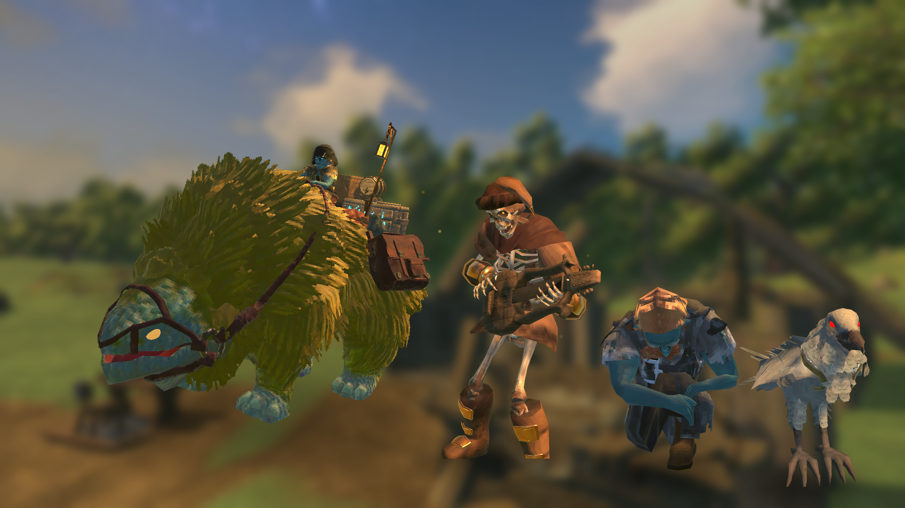
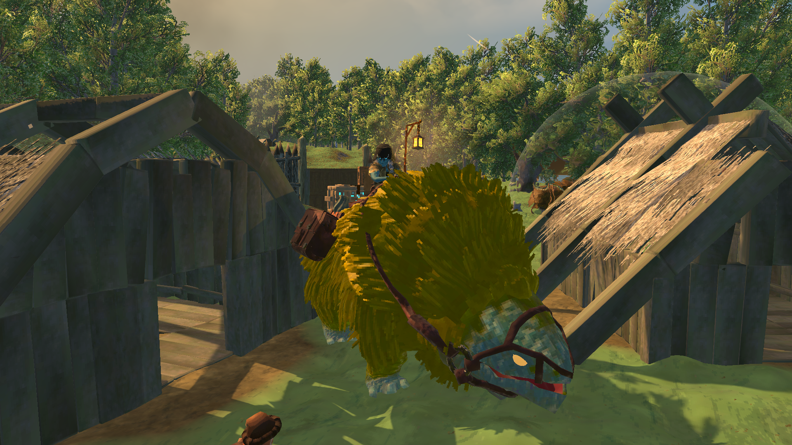
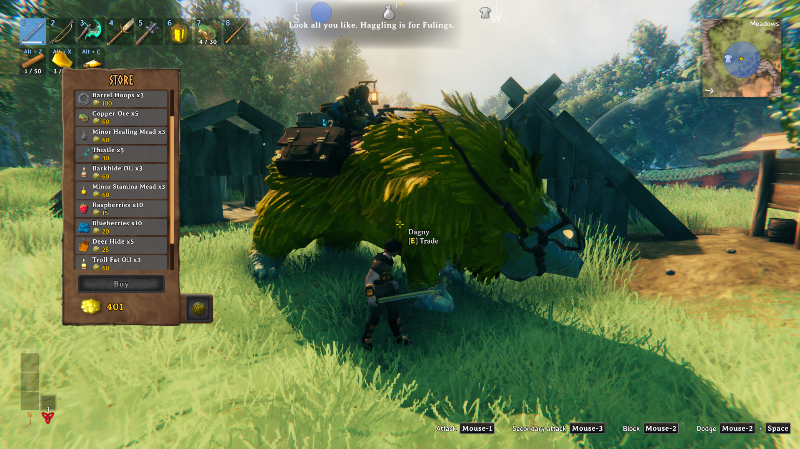
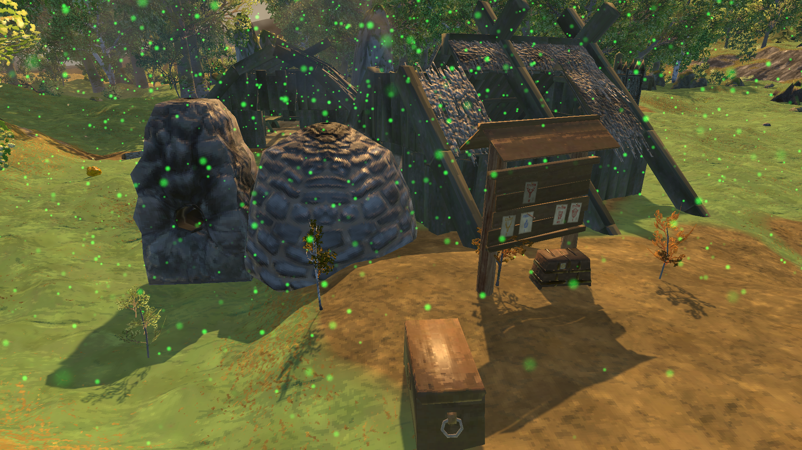
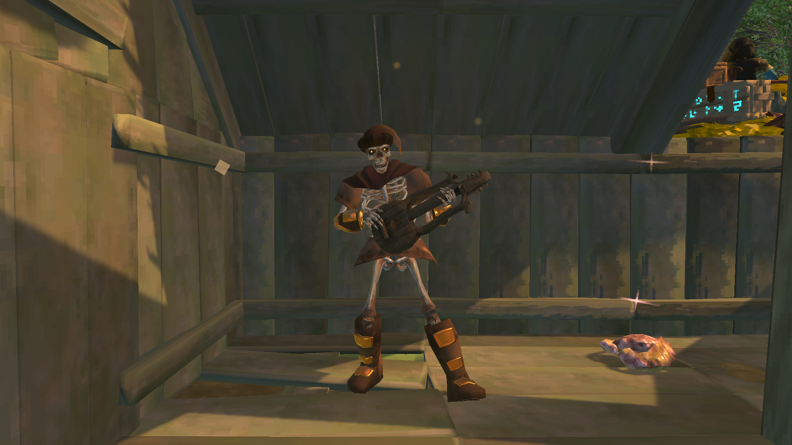
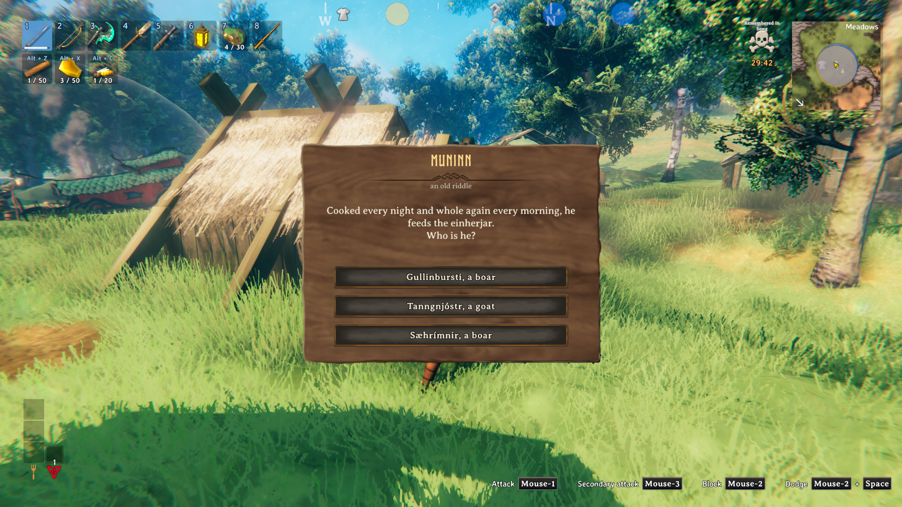
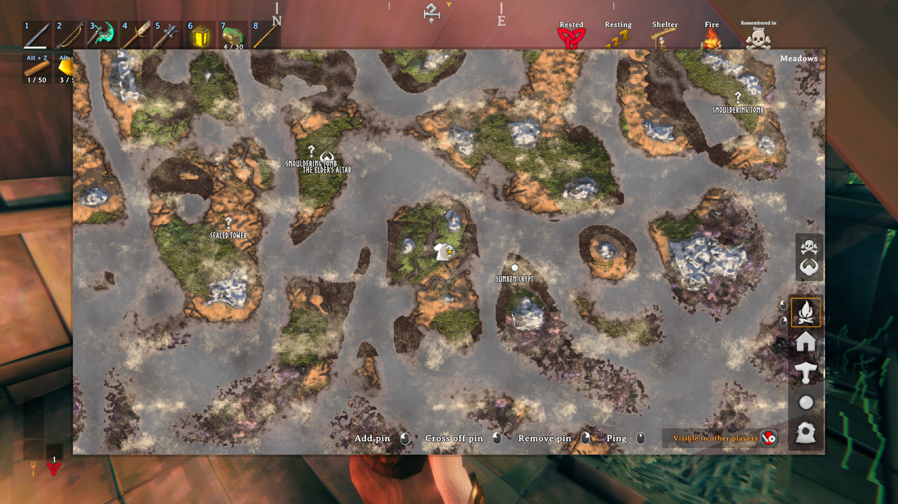
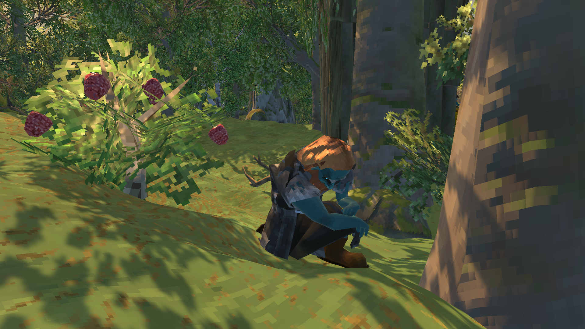
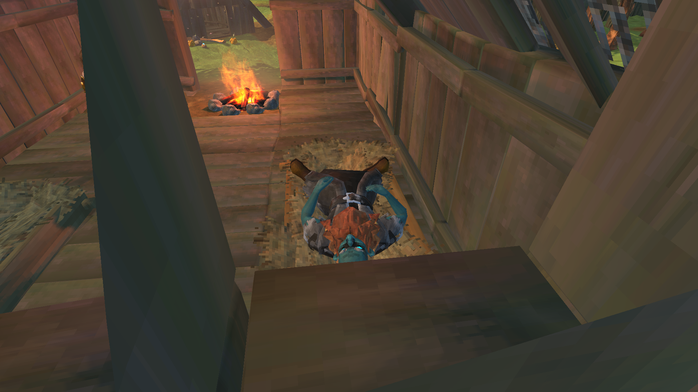

# Good Tidings

Not every visitor wants your head. When the game would send a raid against your base, now and then something good, or at least
interesting, arrives instead: a travelling trader, a season of plenty, Odin's raven with a riddle, a wounded Dvergr, a long-dead skald
with a lyre. Each brings a different kind of reward, and the neutral ones can go either way.

- **Visits take the place of raids.** By default 30% of the raids the game starts become a visit instead (Visit Chance), so raids get
  that much rarer. Visits come only when a player is at a base, as raids do, and no raid starts while a visitor is there.
- **The map shows them** as a raid is shown: a circle on the base (blue for a good visit, yellow for a neutral one), and the visitor's
  mark. Hostile creatures sent at the base turn it red until they're dead or gone.

## The visits

### Dagny and Atlas (good: trade)

A wandering trader rides in on her golden Lox, wanders round the base for a few minutes and trades with anyone who asks. Her goods
follow how far your world has come, from the Meadows to the Deep North: fifteen lines a visit, mostly from your newest lands, with a
fishing rod, bait and barrel hoops always, and one rare item of your newest land. Feed Atlas (drop food near him) and each meal knocks
30% off one of her goods. Ordinary goods can be bought three times a visit, the rare once.

### Bountiful Season (good: time)

A warm season settles over the base for a few minutes: everything in it works faster. Smelters, kilns, fermenters, cooking stations,
beehives and the like work 8 times as fast, and growing plants 20 times.

### The Skald (good: skill)

A long-dead skald, a friendly skeleton with his lyre on his back, rises out of the ground at the most comfortable spot in your base,
strolls about a little, then plays his three songs. While he plays, the comfort around him is 2 higher. Stay near him for 30 seconds
and every skill rises by 5% of its level, and for a while your next death drains no skills ("Remembered in Song"). Once a visit. When
his songs are done he bows and sinks back to his rest.

### Muninn's Riddle (neutral: knowledge)

Odin's white raven of memory lands at the base with a riddle, made from what you yourself have found and made (or, now and then, one
of 26 old riddles from the Eddas and Valheim's story). The first to answer decides:

- **Right:** he shows you what he saw while flying over the world: a dungeon you haven't found, marked on your map with the land around
  it; every third right answer in the world, something more valuable, the next boss's altar or a trader. With nothing left to show,
  he gives an idol of the Forge of Potential and a rare of your newest land instead. Answer one of the old riddles rightly and for a
  while your portals take metals too ("The Raven's Road").
- **Wrong:** he takes flight with a cry, and your newest land's beasts answer it.

The more riddles the world answers rightly, the harder his riddles get.

### The Wounded Dvergr (neutral: craft)

A hurt Dvergr staggers in and goes down on one knee near the base. Help him up and he goes to the nearest fire to rest: a bed by it,
a seat, or the ground beside it (with no fire about, he waits for one to be lit). Feed him three meals from your hotbar before his time
is up and he gets back on his feet, comes over and tempers everyone's gear: repaired, and wearing down at half the rate for 30 minutes.
Leave him, and he limps off cursing; soon after, his kin come for the base, at a strength matched to how far your world has come.

## Other mods' items

Dagny sells other mods' items by herself: anything gathered or dropped in a land, and meads fermented from known things, are placed by
where they come from and priced as that land's own. Server owners can change her stock in `BepInEx/config/nick.GoodTidings.stock.json`
(written with instructions the first time): add items to a land, take any out, or turn the finding off. `goodtidings found` in the
console lists what she found.

## Settings

Everything is in the F1 Configuration Manager. The server decides them all, except the skald's Song Volume and Music Near Skald, which
are each player's own.

| Section | What's in it |
|---|---|
| **01 - General** | On or off, and the share of raids that become visits (Visit Chance, 30%) |
| **02 - Wandering Trader** | On or off, and how long Dagny stays (6 minutes) |
| **03 - Bountiful Season** | On or off, how long it lasts (5 minutes), how much faster things work (8x) and plants grow (20x) |
| **04 - Muninn Riddle** | On or off, how long he waits for an answer (5 minutes), the chance of an old riddle (35%), and how long the Raven's Road lasts (10 minutes) |
| **05 - Wounded Dvergr** | On or off, how long there is to help him (10 minutes), the meals he needs (3), how long gear stays tempered (30 minutes) and how much it wears meanwhile (50%) |
| **06 - Skald** | On or off, the skill gain (5% of each skill's level), how long to listen (30 seconds), how long no skill drain lasts (30 minutes), the comfort he adds (2); and each player's own: his song's volume (80) and the game's music near him (20%) |

`goodtidings visit [trader|bountiful|muninn|dverger|skald]` in the console calls a visit now (the host, or with devcommands on), and
says why if one can't come.

## Playing on a server

- **Multiplayer is untested.** The mod is built for it (each visitor is run by one game and seen by everyone; rewards are given once;
  Muninn's places are picked by the server, which alone knows the whole world), but so far it has only been played in single player.
  If something looks wrong with friends or on a server, please report it.
- The server needs the mod: visits start on the server.
- Every player needs the same content mods, as on any modded server.

## Other mods and known clashes

- No clashes are known.
- It turns a share of the raids the game starts into visits: with a raid mod such as Custom Raids, the share applies to its raids too.
- Its visitors are its own; it changes nothing about the game's own creatures, pieces or items.

## Languages

English, German, French, Spanish, Brazilian Portuguese, Russian, Polish, Turkish and Chinese, following the game's own language
setting. The translations beyond English were written with the help of an AI and haven't been checked by native speakers: corrections
are welcome. To correct a line yourself, put a file named after the language (`German.json`...) in
`BepInEx/config/translations/nick.GoodTidings/` with only the lines you change; it wins over the built-in one.

## Credits

- The skald's playing and bowing are Mixamo animations (Adobe).

## Made with AI

Made with the help of Claude (Anthropic). The skald's songs were made with ElevenLabs, and his lyre with Meshy.
