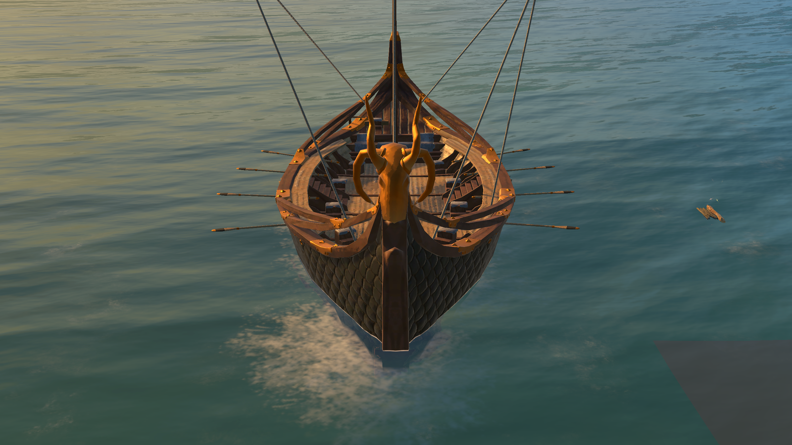
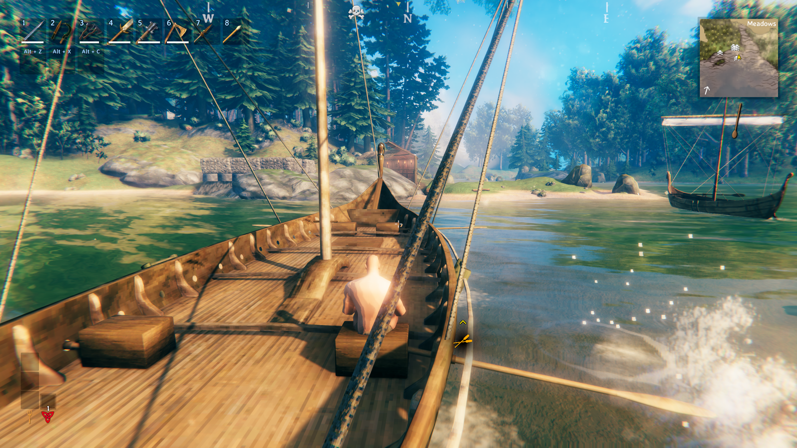
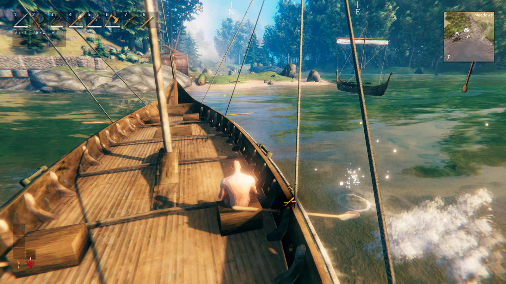
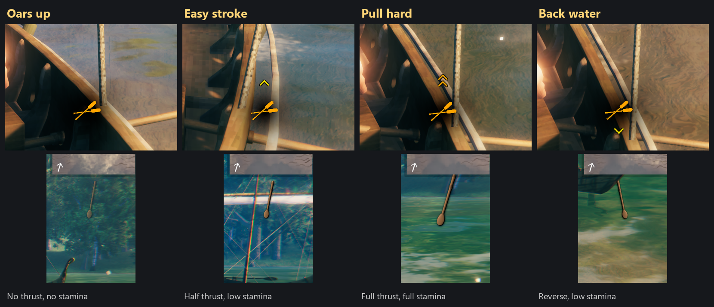
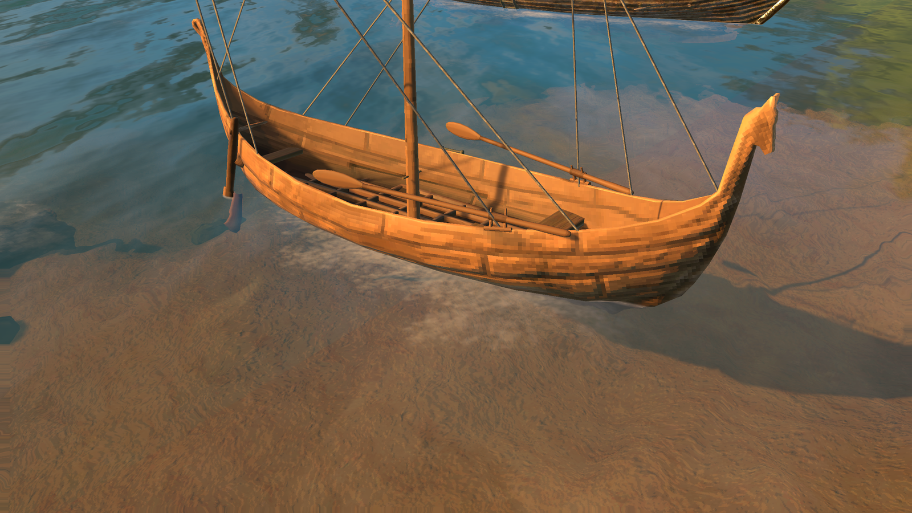
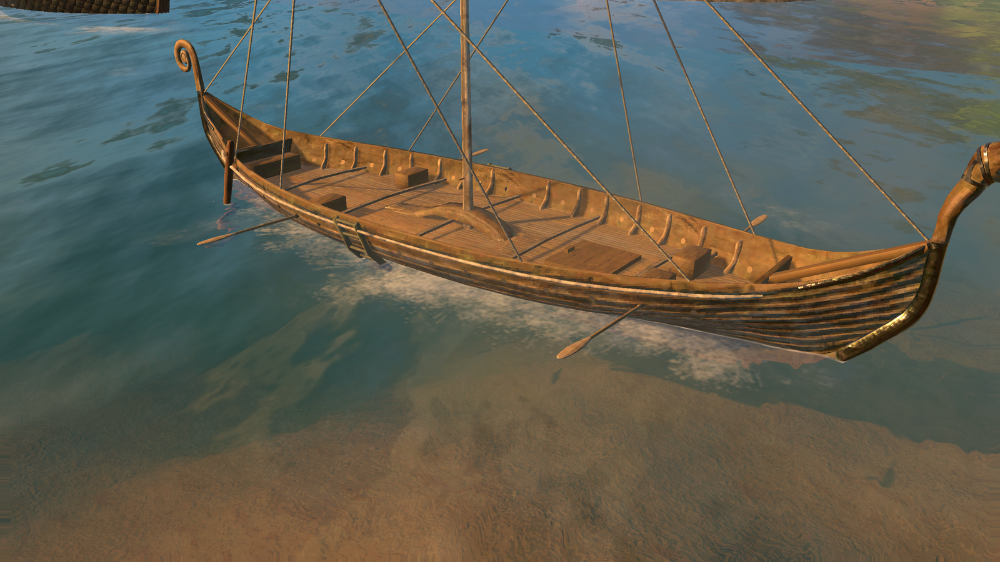
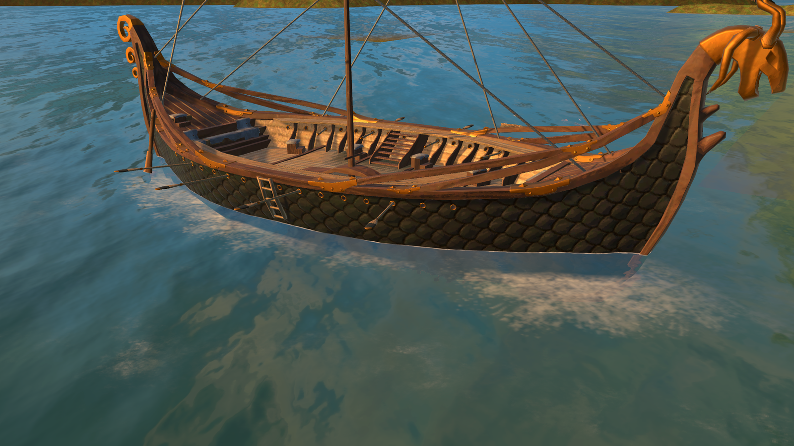
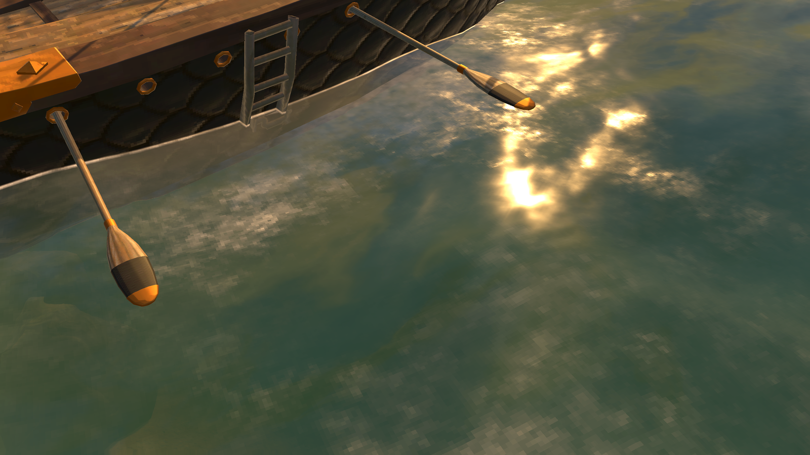
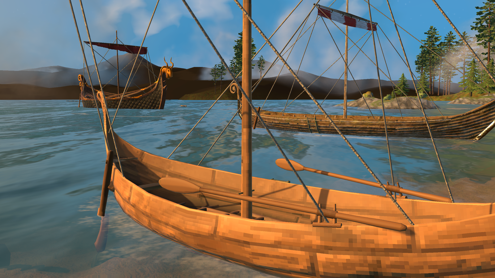

# Heave Ho

Rowing for ships. Sit on a bench of the Karve, Longship or Drakkar and pull the oars: they swing out of the hull, sweep through the water and splash where the blades bite. A crew of rowers goes faster, steers by rowing on one side, and rowing costs stamina.

- **Row from any rowing bench.** Sit down and shift your stroke with the same keys as the helm: oars up, easy stroke, pull hard, back water.
- **Real oars on every ship.** Each ship has its own oar, made to match its hull. The Longship's and the Drakkar's go through the hull's own oar ports; the Karve's ride in a small wooden oarlock on its gunwale.
- **A crew is faster, and steers.** More rowers add speed (with diminishing returns). Each oar pushes from its own side, so rowing on one side turns the ship, and port pulling with starboard backing water spins it on the spot.
- **Water you can see.** Blades turn flat in the air and upright in the water, the stroke follows the real height of the water, and a splash appears only where a blade really meets it.
- **Made for rowers.** You see your stroke arrows by your oarlock and an oar icon under the minimap that shows your gear. The wind indicator stays at the helm, where the sail is.
- **Fair in multiplayer.** The server decides how the ship rows; each player keeps their own look.

## Controls (seated on a rowing bench)
The keys below are the defaults: the on-screen hint shows whatever you have bound. Shifting the stroke is "move forward / back", so a controller's left stick works too, and Jump stands you up.

| Key | Stroke |
|---|---|
| (sit down) | **Oars up**: default, no rowing, no stamina |
| W | Oars up → Easy stroke → Pull hard |
| S | Pull hard → Easy stroke → Oars up → Back water |
| Jump | Stand up (stroke resets) |

- **Easy stroke**: half thrust, low stamina. **Pull hard**: full thrust, full stamina. **Back water**: reverse, low stamina.
- Oars alone can move a stopped ship with the sail stowed.
- Your arrows float by your oarlock: one arrow is Easy, two are Pull hard, a back arrow is Back water. Under the minimap an oar icon shows your gear too: dim with the oars up, solid at Easy, larger at Pull hard, flipped for Back water, swelling a little with every stroke.
- A rower has no sail to trim, so the wind indicator is hidden while you row and comes straight back when you stand up or go to the helm.

## The ships

**Karve.** Two rowing seats. Each oar rides in a small round wooden oarlock set on the gunwale, tilted to follow the hull. At rest the oars lie along the gunwale.

**Longship.** Four rowing seats. Each oar goes through the nearest of the hull's eight oar ports a side, square to the planking.

**Drakkar.** Eight rowing seats. The oars have oak looms, brass collars and blades in the hull's own green scales, and go through the brass-ringed ports.

The Raft has no seats and is left alone. Each oar goes through the port nearest its seat, and the ghost you see while placing a ship with the hammer shows its oars out too. Modded ships with sitting benches get oars automatically, measured from their rail, with a common oar.

- **At rest** the oars stay out (Karve: along the hull; Longship and Drakkar: level through their ports). Turn **Oars at rest** off in a ship's F1 section and an oar slides out of its port when its rower starts, and back in when they stop.
- **Ship the oars under sail** (off by default): while the sail is up and the ship is moving, oars nobody is pulling slide in out of sight, and come back out when someone rows or the ship slows.

## Settings (F1)
Tick **Advanced settings** at the top of the menu to see the fine-tuning options marked *(adv)*.

| Section | What's in it |
|---|---|
| **1. Rowing** | How rowing plays: Rower strength, Easy / Back water thrust, Turning strength · *(adv)* Max rowing speed, Rower bonuses |
| **2. Stamina** | What it costs: Stamina per second, Easy / back water stamina, Resume rowing at |
| **3. Oars and splashes** | How the oars look: Show oars, Oar size, Stroke rate, Ship the oars under sail, Oar splashes and the splash effects |
| **4. Rower HUD** | Where the rowing arrows float: distance outboard and height |
| **5. Ship: Karve / Longship / Drakkar** | Per ship, the first time you meet it: Oar visuals, Oar physics, Oar size, Oars at rest, Oar position (out / up) · *(adv)* Rowing seat names. Modded ships: Oarlock placement and its sliders instead of Oar position |
| **9. Advanced** | *(adv)* Rowing seat animations |

- **Oar visuals / Oar physics** are independent. Physics only = an invisible crew still rows; visuals only = cosmetic rowing; both off = ordinary seats.
- **Oar position** moves every oar of a vanilla ship out or up from where its hull puts it. Modded ships keep *Oarlock placement*: *Fixed* uses one distance and height for every bench; *Per seat* measures the rail beside each seat and spreads oars that share a bench.
- Almost everything applies live. Seat names and placement apply to ships loaded after the change.

## Multiplayer
- Every player needs the mod. Each client animates the oars and splashes; the ship's owner (usually the helmsman) applies the thrust.
- Rowers ping the owner every second. A rower who disconnects drops out within about 3 seconds.
- **The server decides how the ship rows.** Joining a server that has Heave Ho, you play by the server's values for strength, thrust, stamina, turning, oar position and seats; your own config file is untouched and comes back when you leave. They show read-only in Configuration Manager. The host and server admins (adminlist.txt) can change them from their own game, and a dedicated server's owner can edit the .cfg while it runs.
- Only what you *see* stays yours: the oars' look (**Show oars**, **Oar size**, **Stroke rate**, **Ship the oars under sail**, each ship's **Oar visuals**, **Oar size** and **Oars at rest**), the splashes and the rower HUD.
- A server without the mod sends nothing, so your own values apply.

## Other mods and known clashes
- **Other rowing mods.** TogetherWeRow, AllHandsOnboard and PaddlePower also let passengers or rowers add to a ship's speed, and AllHandsOnboard animates oars of its own. Two mods doing the same job on one ship would push twice, so use one at a time; I haven't tested them together.
- **ValheimRAFT** also changes the ship HUD (`Hud.UpdateShipHud`); I haven't tested the two together, so use them one at a time until I have.
- **Rowing takes over W / S** while you sit on a rowing bench (it changes the move input of `Player.SetControls`, as other mods that rebind keys do). Spyglass, Server devcommands, BetterArchery and similar mods change other inputs of the same method; they work side by side, but I haven't tested each of them at a bench.
- Mods that add their own ships with benches get oars automatically; ones that aren't built like the vanilla ships may need their seat names set in F1.
- Mods that only change a ship's speed or sail (ShipSpeed, ShipConfig, Smooth Sailing) change numbers this mod doesn't use, so they should work alongside it.

## Languages
English, German, French, Spanish, Brazilian Portuguese, Russian, Polish, Turkish and Chinese. The translations beyond English were written with the help of an AI and haven't been checked by native speakers: corrections are welcome (put a file such as `German.json` in `BepInEx/config/translations/nick.valheim.heaveho/`).

## Your own oars and icons
Next to `HeaveHo.dll` (in the mod's folder) you can replace:
- **`oar_karve.obj`, `oar_longship.obj`, `oar_drakkar.obj`**: the three ships' own oars (any ship can have one: `oar_<name>.obj`, the name as in F1, lower case). Without a texture file they are drawn with the ship's own hull material, their UVs pointing into the hull's texture. `oarlock_karve.obj` is the Karve's wooden oarlock.
- **`oar.obj`** + its texture (`oar.jpg` / `oar.png`, or whatever `oar.mtl` names): the common oar, for ships without their own. Blender export: File → Export → Wavefront (.obj), Forward -Z, Up Y, Selected Only. Model the blade along +X with the origin at the oarlock, in meters.
- **`oarIcon.png`**: replaces the helm wheel in the rowing HUD (transparent background). **`rowingPowerIcon.png`** (213 × 377): the oar icon under the minimap.

## Troubleshooting
- Every ship's seats, oarlock measurement and settings are logged to `LogOutput.log` the first time it loads (search `[Karve]`, `[VikingShip]`, `[VikingShip_Ashlands]`).
- Water effects you can use for splashes are logged under `[Splash]`.

## Made with AI
Made with the help of Claude (Anthropic).
