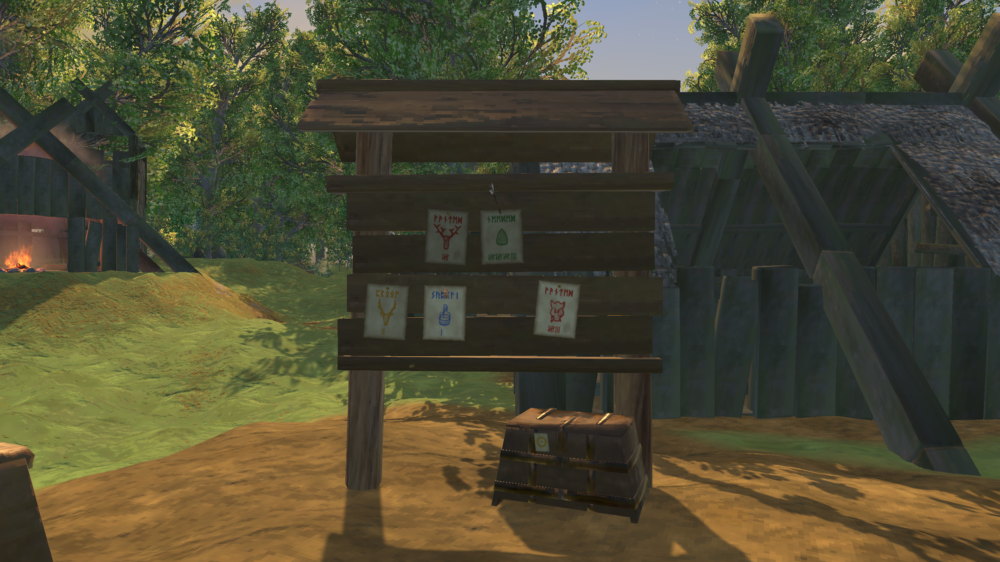
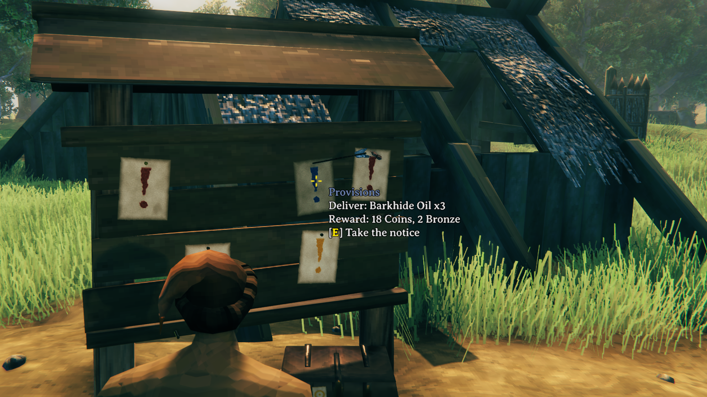
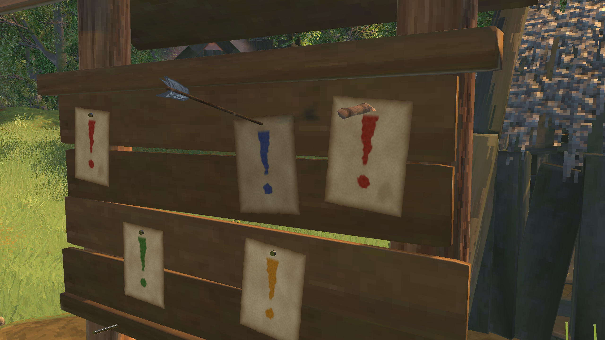
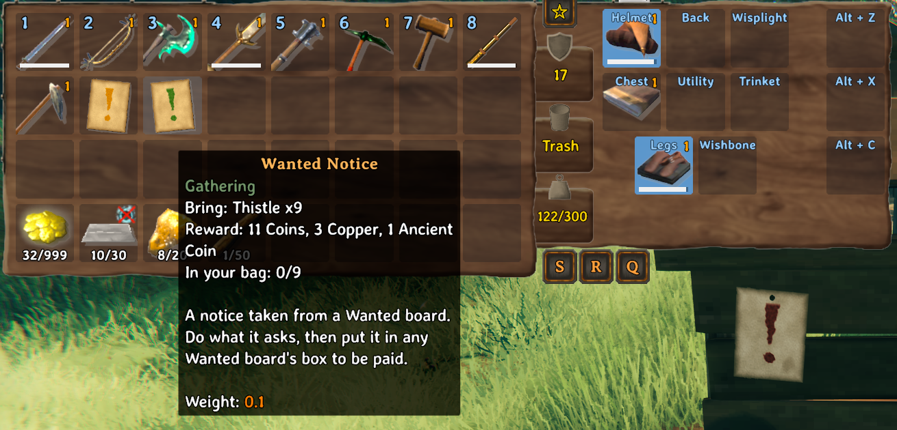
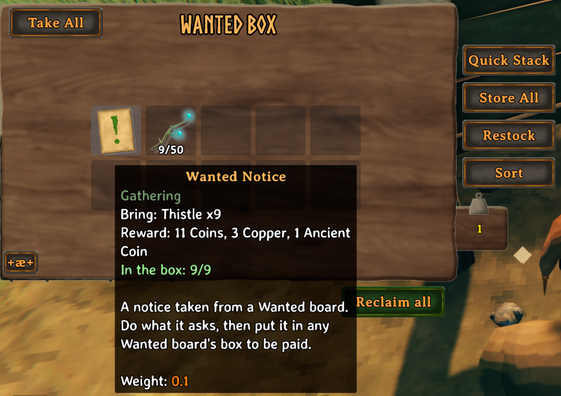
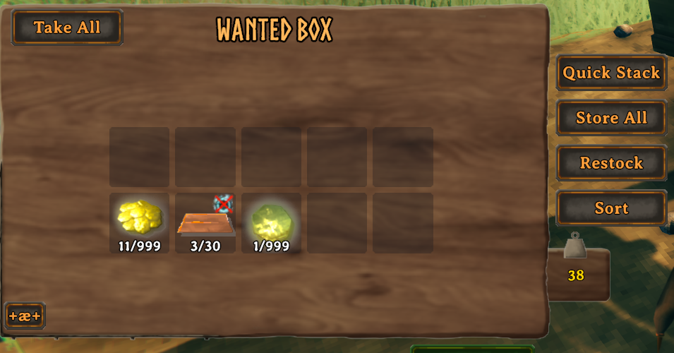
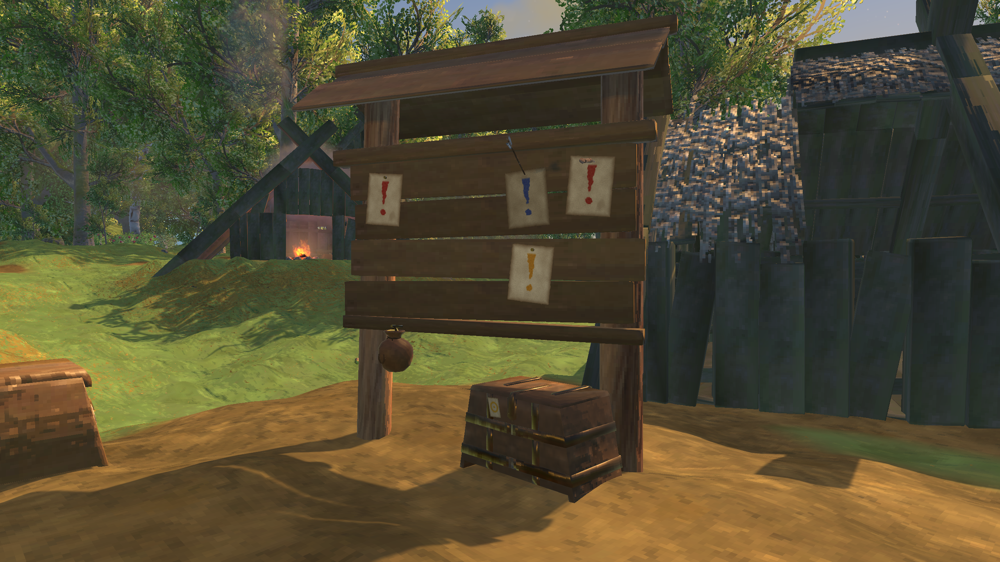

# Wanted!

A notice board for your village. Build it, and each morning it posts notices: creatures to slay, things to gather, trophies to bring
and food to deliver. Take a notice, do what it asks, and drop it in the board's box to be paid.

- **Notices you can read on the board.** Each one is an old sheet of paper with an ink sketch of what it wants (a creature's trophy,
  the item), the count in tally marks and its kind's word in runes, inked in its kind's colour: red for a bounty, green for gathering,
  amber for trophies, blue for provisions. Look at one to read it. Press E to take it. The notice in your bag shows the same sketch.
  Prefer it plainer? "Illustrated notices" off (each player's own setting) paints a simple exclamation mark instead, and "Heading"
  swaps the runes for WANTED in letters, or nothing.
  Now and then a notice is pinned with an arrow or a knife instead of a nail.
- **Work that suits your world.** Notices follow how far the world has come: every boss beaten opens the next land's creatures,
  things and food, from the Meadows to the Deep North. Notices can be for any land you've opened: about half are for the newest,
  a quarter for the one before it, and so on, so older lands keep turning up late in the game.
- **Four kinds of notice.**
  - **Bounty** (red): slay a number of a creature. Kills count for you and for everyone fighting within 30 m of the creature.
  - **Gathering** (green): bring materials.
  - **Trophies** (amber): bring trophies, usually one or two. Rare drops, so they pay like a bounty on all the kills it takes.
  - **Provisions** (blue): deliver cooked food, meads or oils.
- **A notice is a paper you carry.** Taken from the board, it goes in your bag: its tooltip says what it asks, what it pays and how
  far along you are ("Slain: 4/8", or "In your bag: 12/19"). A finished bounty gets a red wax seal on its icon.
- **Hand it in at the box.** Put the paper (and what it asks for) in any Wanted board's box and close the lid: the box checks it,
  takes it, and puts the reward in its place, with the sound of coins. A leather coin pouch hangs on the board while a reward waits in
  the box. Nothing is taken unless everything is there.
- **Rewards worth the trouble.** Coins and a material of the notice's land (resin and flint early on, then copper, iron, silver, black
  metal and flametal), worked out from what the notice asks. On top of that, now and then:
  - something useful of its land (meads and oils, arrows and bolts, refined goods such as Refined Eitr, linen thread and nails), 20%;
  - a valuable (amber, rubies, silver necklaces...), 10%;
  - a rare find (a boss's summoning item, Dragon Tears, Thunderstones, Sealbreaker fragments, Bell fragments...), 5%;
  - an idol of the Forge of Potential, 3%: of any land you've opened, each as likely, so older idols never run out.

*Most notices are nailed up. Some aren't.*

 
*Before and after: close the lid, and the notice and what it asked for turn into the reward.*

*While a reward waits in the box, a coin pouch hangs on the board.*

## The board

Build it with the hammer at a workbench: 20 Wood, 4 Resin and 2 Leather Scraps (the server can change the cost). It's a plank board on
two log posts under a small roof, with an iron-banded box at its foot.

- **A new board starts bare** and gets its first notices (three to five) at the next dawn.
- **Each dawn after that**, while it has room, it posts at least one more: one, two or three most mornings, now and then four or five.
- It holds **five notices at most**, in any of ten places.
- **No board within 50 m of another**: the build ghost turns red and says how far the other board is.
- You can carry **three notices at a time**.
- Every player sees the same notices on a board: they're saved on the board itself. Two players can't take the same notice.

## Other mods' creatures and items

Wanted finds other mods' content by itself: install a mod that adds creatures, food or metals and its things start turning up on boards.

- **Creatures** in the world's spawn lists, at the stage of the land they live in, worth what a game creature of that land and
  strength is worth (bosses and their minions aside). Their trophies and common drops too.
- **Things to gather**: what the world's rocks, plants and trees give, and what those creatures drop.
- **Food, meads and oils** made from things it knows, at the stage of their ingredients.
- **Rewards**: metals smelted from a new ore, arrows and bolts (by what they're made of), and valuables (by their price at the trader).

To fine-tune it, a server owner can add or take out anything in `BepInEx/config/nick.valheim.wanted.contracts.json` (made with an
example the first time the game runs): what a notice can ask for, what it pays, what it's worth. On a server, the server's file applies
to everyone. Notices for something the game no longer has (a mod was removed) come down from the boards by themselves.

## Settings

Everything is in the F1 Configuration Manager. The server decides all of them.

| Section | What's in it |
|---|---|
| **1 - Building** | The board's cost and crafting station, and the least distance between two boards (50 m) |
| **2 - Notices** | The newest land's share of notices (50%: the rest go to older lands, each half as often as the next), the most notices on a board (5), how many a new board gets at its first dawn (3 to 5), the chances of more notices each dawn ("75, 55, 40, 20": a second, a third...), and how many a player can carry (3) |
| **3 - Rewards** | The pay as a percentage (100), and the chances of an idol (3%), a useful bonus (20%), a valuable (10%) and a rare find (5%) |
| **4 - Looks** | The chances a notice is pinned with an arrow (15%) or a knife (10%) |

## Playing on a server

- **Multiplayer is untested.** The mod is built for it (a board's notices are saved on the board and posted by the game running its
  area; taking a notice asks that game first; kills are shared with everyone near), but so far it has only been played in single
  player. If something looks wrong with friends or on a server, please report it.
- The server needs the mod: a server without it would delete the boards. A player who has the mod on a server that doesn't simply
  doesn't get the board in the hammer.
- Every player needs the same content mods, as on any modded server: notices are written by the game of the player whose area the
  board is in.

## Other mods and known clashes

- No clashes are known.
- It adds its own board, box and notice and changes nothing about the game's own pieces, items or creatures.
- It reads other mods' creatures and items (see above) and needs nothing from them.

## Languages

English, German, French, Spanish, Brazilian Portuguese, Russian, Polish, Turkish and Chinese, following the game's own language
setting. The translations beyond English were written with the help of an AI and haven't been checked by native speakers: corrections
are welcome. To correct a line yourself, put a file named after the language (`German.json`...) in
`BepInEx/config/translations/nick.valheim.wanted/` with only the lines you change; it wins over the built-in one.

## Made with AI

Made with the help of Claude (Anthropic).
