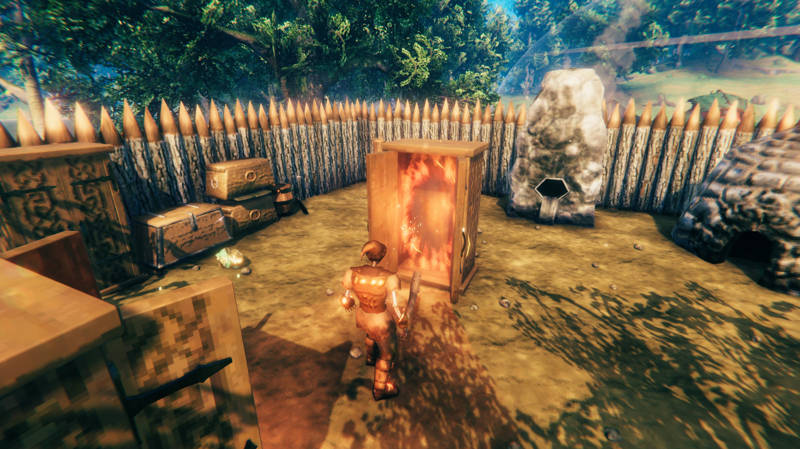
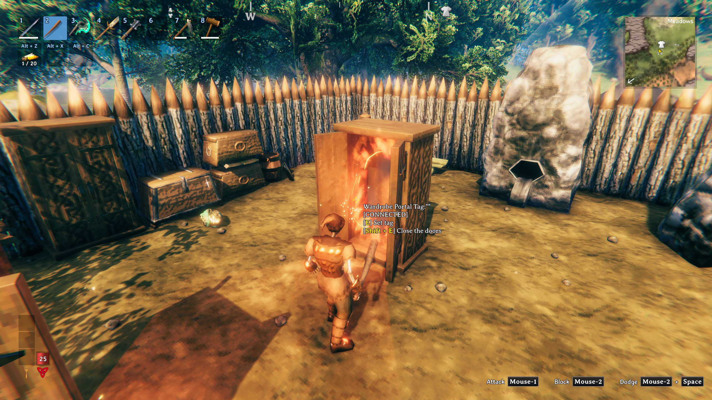
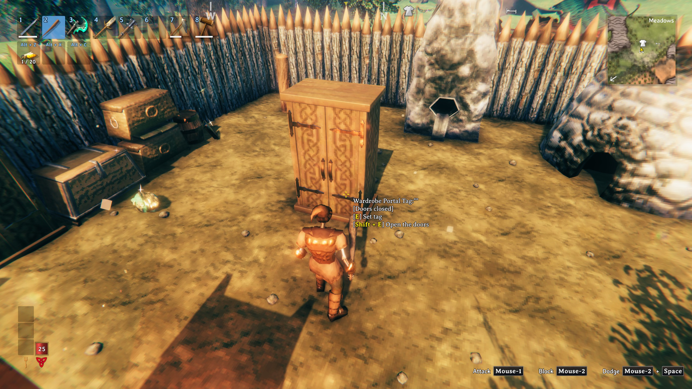

# Wardrobe Portal

A portal you build as the Deep North wardrobe. Walk up to it and its two doors swing open, with the portal swirling inside; step in
and you come out at the other end. Shut the doors and the portal sleeps: no swirl, no way in, and no doors flapping open every time
you walk past.

## How it works

- **Build it** with the hammer, among the game's own portals. It costs what a wardrobe does plus what makes a portal:
  10 Frostwood, 2 Tar, 6 Black Metal, 2 Surtling Cores and 10 Greydwarf Eyes, at a workbench.
- **It is a portal**: give it a tag with **E**, as on any portal. It pairs by tag with another Wardrobe Portal or with any of the
  game's portals, and lets through what a wooden portal lets through (no metals).
- **The doors open as you come near** (within 4 metres) and close again when everyone has walked away.
- **Shift+E shuts the doors** and puts the portal to sleep: they stay shut when you walk up, and nobody can go in. **Shift+E** again
  opens them. Shut or open is saved with the piece, and every player sees the same.
- **Coming out of a shut wardrobe**: someone who travels to a wardrobe whose doors are shut still gets out. The doors swing open and
  the swirl shows for a few seconds as they arrive, then the doors shut again.
- **It is a wardrobe when you hit it**: its doors are solid, it takes damage and breaks like a wardrobe (its sounds, its splinters,
  its toughness), not like a stone portal.

## Settings

In `BepInEx/config/nick.valheim.wardrobeportal.cfg`, or in game with Configuration Manager (F1).

| Setting | Default | What it does |
|---|---|---|
| 1 - Building: Cost | `Frostwood:10, Tar:2, BlackMetal:6, SurtlingCore:2, GreydwarfEye:10` | What it costs to build (item prefab names and amounts). |
| 1 - Building: Station | `piece_workbench` | The crafting station that must be near. |
| 2 - Doors: Open distance | 4 | How close (metres) a player comes before the doors open. |
| 2 - Doors: Open angle | 110 | How far the doors swing open (degrees). |
| 2 - Doors: Door speed | 180 | How fast they swing (degrees a second). |

The building settings come from the server when it has the mod (the server owner decides the cost); the door settings are each
player's own.

## Multiplayer

- **The server needs the mod**, as for any mod that adds a build piece: a server without it deletes the wardrobes. Players on a
  server without it don't see the piece in the build menu.
- Every player needs it too, to see the wardrobe (without it they see nothing there).
- So far it has been played in single player only. If something looks wrong with friends or on a server, please report it.

## Other mods and known clashes

- No clashes are known.
- It changes nothing about the game's own portals or wardrobes. Mods that change how portals pair or what may go through them
  (such as XPortal or Adventure Backpacks) haven't been tried with it.
- The two doors are made from the game's wardrobe model when the game starts (the game's wardrobe opens only one door). If a game
  update changes that model, the wardrobe keeps working with one door until the mod is updated.

## Languages

English, German, French, Spanish, Brazilian Portuguese, Russian, Polish, Turkish and Chinese, following the game's own language
setting. The translations beyond English were written with the help of an AI and haven't been checked by native speakers: corrections
are welcome. To correct a line yourself, put a file named after the language (`German.json`...) in
`BepInEx/config/translations/nick.valheim.wardrobeportal/` with only the lines you change; it wins over the built-in one.

## Made with AI

Made with the help of Claude (Anthropic).
