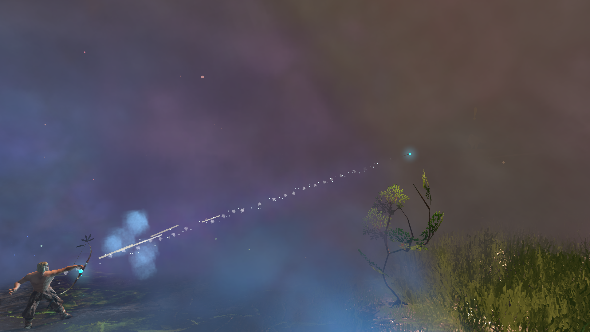
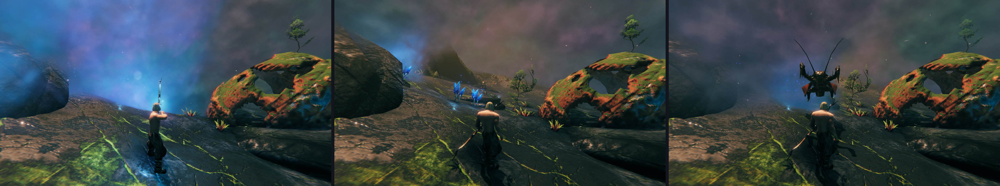
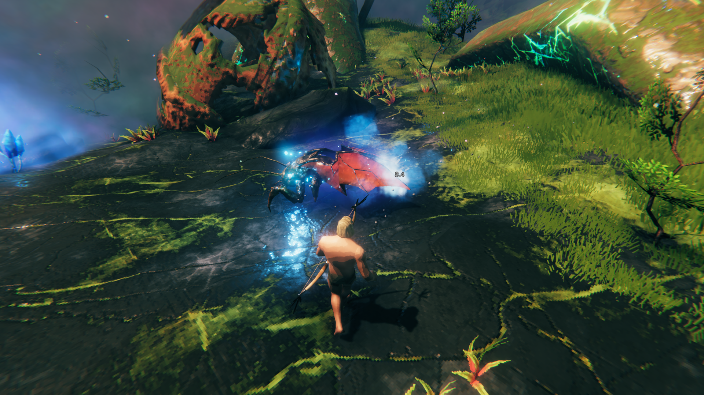
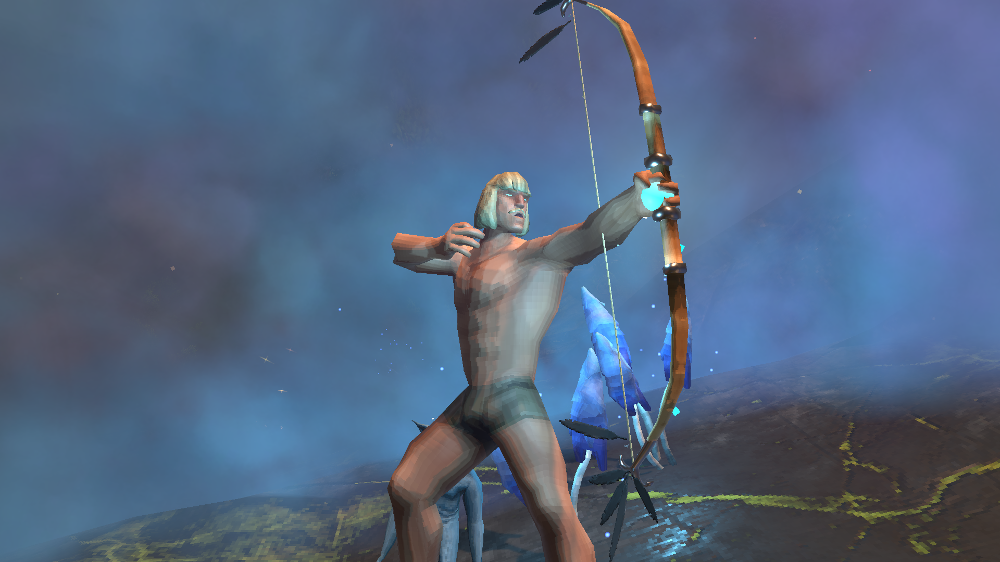
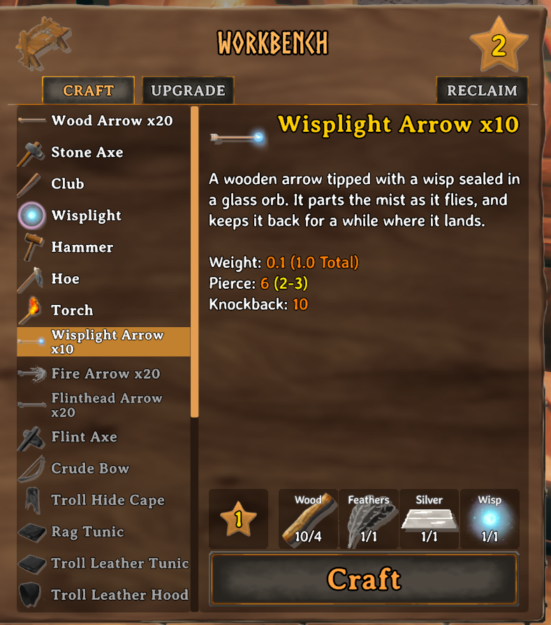
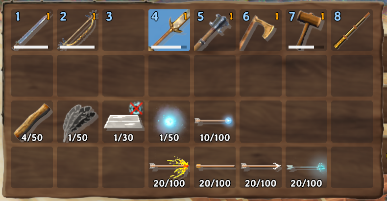

# Wisplight Arrows

Arrows tipped with a wisp sealed in a glass orb. They do little damage: they're for seeing your way through the Mistlands.

- **They part the mist as they fly.** The wisp on the arrow pushes the mist aside along its whole path, and the path stays clear for a few seconds before the mist closes in again behind it.
- **They light up where they land.** Where the arrow strikes the ground, a tree or a rock, the wisp stays and keeps the mist back for a minute, then slowly fades as the mist rolls back in. It sits on the part of the arrow that's sticking out, never buried in the ground.
- **Mark a creature.** Shoot one into a creature and the wisp rides along on it for the same minute, held where the arrow went in, so you can see it moving through the mist.
- **A wisp on the bow.** While you draw one, a small wisp glows at your bow hand and clears the mist a little way round you.
- **Dropped, they glow.** An arrow lying on the ground glows faintly at its orb (it doesn't clear any mist).
- **Everyone sees it.** Other players with the mod see the glows, the wisps on creatures and the wisp on your bow.

*Before, after, and why you might not want to see what's out there.*

## Crafting

At a workbench (level 1): 4 Wood, 1 Feathers, 1 Silver and 1 Wisp make 10 arrows. A server owner can change the cost, the station and how many a craft makes in the server's config.

Each arrow does 6 pierce damage of its own (a wooden arrow does 22), on top of the bow's.

 

## Settings

Everything is in the F1 Configuration Manager. The server decides all of them.

| Section | What's in it |
|---|---|
| **1 - Mist** | How far the mist is cleared round a flying arrow (10 m) and where it lands (15 m, the same as a Wisplight), how long a landed one lasts (60 s), how long the flight path stays clear (4 s), and how far the wisp on your bow clears (5 m) |
| **2 - Arrow** | Its pierce damage |
| **3 - Crafting** | The cost, the station and level, and how many arrows a craft makes |

## Playing on a server

- **Multiplayer is untested.** The mod is built for it (the glows and the wisps on creatures and bows are shared with other players), but so far it has only been played in single player. If something looks wrong with friends or on a server, please report it.
- The server needs the mod for the arrows to be craftable and kept: a server without it would delete them. A player who has the mod on a server that doesn't simply doesn't get the recipe.
- The glows are temporary objects every player's game sees. They're never saved with the world, and one goes when the player who shot it leaves.
- Players without the mod don't see the glows, and the mist stays as it is for them.

## Other mods and known clashes

- No clashes are known.
- It clears the mist the way the game's own Wisplight does, so mods that change the mist or the Wisplight may change how it looks.
- It adds its own arrow and changes nothing about the game's arrows or bows.

## Languages

English, German, French, Spanish, Brazilian Portuguese, Russian, Polish, Turkish and Chinese. The translations beyond English were written with the help of an AI and haven't been checked by native speakers: corrections are welcome.

## Made with AI

Made with the help of Claude (Anthropic).
